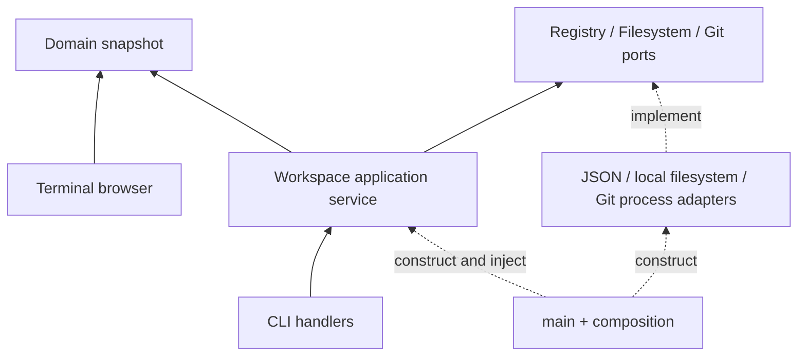

# Hexagonal architecture

[Documentation](../README.md) / Explanation

Spacer uses hexagonal architecture organized into presentation, domain, and data
layers. Dependencies point inward: presentation and data depend on the domain
core; the core has no dependency on either. A composition root connects the
concrete adapters to application services at startup.

## Presentation

`src/cli/` parses arguments and formats results. It calls `Workspace` use cases
and does not construct adapters, load JSON, or coordinate persistence. The
read-only TUI in `src/tui/` renders an owned `WorkspaceSnapshot`; it cannot mutate
storage through that snapshot.

`src/main.rs` and `src/composition.rs` form the composition root. They resolve
`SPACER_ROOT`, the current directory, and session context overrides, construct
the concrete adapters, and inject them into the service. Workspace loading
happens before the TUI changes terminal modes. Shell integration is dispatched
without opening a workspace.

A future graphical presentation can construct the same service with an explicit
workspace path and translate its results into UI messages. Tauri-specific types
and serialization would belong to that presentation bridge. No desktop app is
included in this implementation.

## Domain and application services

`spacer-core` has no external crate dependencies. It contains:

- `model/`: spaces, projects, tracking changes, observed Git worktrees, session
  context, and workspace snapshots. These types have no filesystem methods or
  serialization annotations.
- `services/`: the `Workspace` inbound application API. It owns duplicate and
  existence checks, operation ordering, metadata-only deletion semantics,
  effective context resolution, and primary-worktree protection.
- `ports/`: outbound interfaces for registry persistence, directory creation,
  and Git operations. Concrete adapters implement these interfaces.
- `error.rs`: typed error categories that presentation adapters can distinguish
  without parsing a display string.

The model captures the workspace → space → project → change hierarchy. A `Change`
remains a tracking record; a `Worktree` represents actual Git state, including its
observed path, optional branch, and whether it is the primary checkout. Keeping
these types separate avoids claiming that a metadata entry is a real checkout.

The service exposes concrete use cases rather than selecting a backend with
implicit side effects. `create_project` creates a directory and record;
`create_git_project` explicitly also initializes Git. Likewise `start_change`
and `finish_change` manage tracking, while `start_worktree` and `close_worktree`
operate on real checkouts. CLI commands continue to use the tracking operations.

## Data adapters

`spacer-data` depends on `spacer-core`, never the reverse. Its three adapters
serve complementary purposes:

| Adapter | Port | Responsibility |
| --- | --- | --- |
| `JsonRegistry` | `Registry` | Convert between domain snapshots and the existing `.spacer/config.json` schema; load and save it. |
| `LocalFilesystem` | `Filesystem` | Create directories requested by a use case. |
| `GitCli` | `Git` | Initialize repositories; list, add, and remove Git worktrees through subprocesses. |

JSON DTOs and Serde belong to the registry adapter. The Git adapter has no active
context, registry, or project-deletion method. Listing worktrees preserves actual
Git paths and detached entries; closing a worktree uses its observed path rather
than guessing a directory from a branch name. The filesystem port deliberately
has no recursive-delete operation.

All ports are `Send + Sync`, so their implementations can be used by threaded
presentations. This does not make registry writes atomic or concurrency-safe.
The ports are synchronous; a future GUI must schedule blocking I/O off its UI
thread and serialize access to a mutable service instance.

## Example operation: create a project

1. The CLI parses a name, optional space, and optional path.
2. The service resolves the registered parent and rejects duplicates.
3. The filesystem adapter creates the directory.
4. The registry adapter saves the proposed updated snapshot.
5. Only after a successful save does the service replace its in-memory state.
6. The CLI prints success.

The caller does not call `save()` separately. An error is returned if an adapter
fails, and failed persistence does not publish new in-memory state. Filesystem
and Git effects are not transactional with registry writes: a directory or Git
repository can remain after a save failure. The service does not remove user
files as an automatic rollback.

## Testing and current boundaries

Core tests use small port fakes to test policies, ordering, failures, and context
without accessing the filesystem or Git. Adapter integration tests use temporary
directories and real Git to check schema compatibility, worktree lifecycle, dirty
checkout refusal, and external worktree paths. CLI tests spawn the binary to
verify composition, persistence between invocations, and environment precedence.

The existing JSON schema and metadata-based CLI behavior are preserved. Known
limitations remain: non-atomic configuration writes, no cross-process locking,
no ancestor discovery, and no cleanup of child records or active context when
unregistering. The architecture makes those policies central rather than fixing
all of them as part of the structural refactor.

The previous interchangeable `Backend`/store adapters have been removed. See the
[Rust API reference and migration notes](../reference/rust-api.md) for construction,
ports, and compatibility details.
